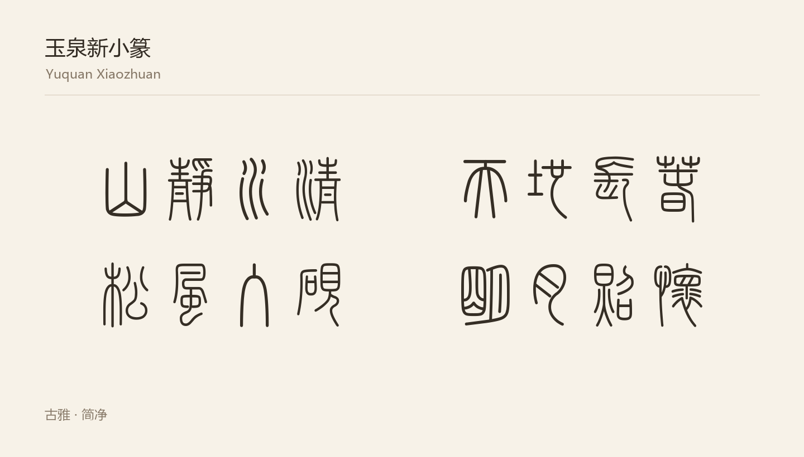

# 玉泉新小篆 · Yuquan Xiaozhuan

一款注重古雅气韵、字形协调与日常输入体验的篆书字体。

## 字体名称

在 Word 等软件的字体列表中选择 **玉泉新小篆**。

英文名称：**Yuquan New Xiaozhuan**。

## 使用

安装字体后，重新打开 Word 等软件即可选择。支持简繁及部分异体字输入；遇到多义字或一简对多繁的情况，建议使用准确的繁体或古字输入，并按文意校稿。

字体文件将通过本仓库的 [Releases](https://github.com/3SamuelW/yuquan-xiaozhuan/releases) 提供。当前尚未发布可下载的发行包。

## 问题反馈

欢迎通过 [Issues](https://github.com/3SamuelW/yuquan-xiaozhuan/issues) 反馈缺字、显示异常及使用建议。请附具体文字、软件版本及截图，便于定位。

## 使用范围

本项目目前面向非商业使用。版权与许可范围见 [版权说明](NOTICE.md)。
